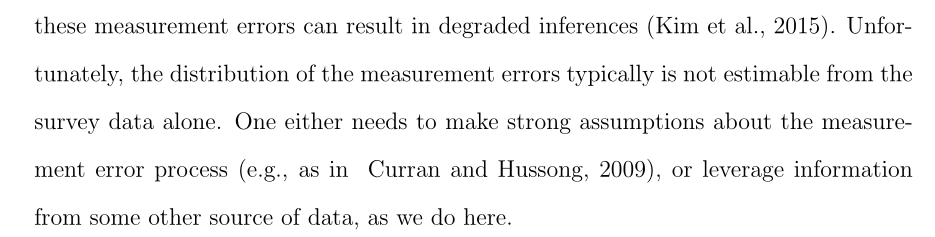

# Getting Started with pdfsearch

This package defines a few useful functions for keyword searching using
the [pdftools](https://github.com/ropensci/pdftools) package developed
by [rOpenSci](https://ropensci.org/).

## Basic Usage

There are currently two functions in this package of use to users. The
first `keyword_search` takes a single pdf and searches for keywords from
the pdf. The second `keyword_directory` does the same search over a
directory of pdfs.

## `keyword_search` Example

The package comes with two pdf files from [arXiv](https://arxiv.org/) to
use as test cases. Below is an example of using the `keyword_search`
function.

``` r

library(pdfsearch)
file <- system.file('pdf', '1610.00147.pdf', package = 'pdfsearch')

result <- keyword_search(file, 
            keyword = c('measurement', 'error'),
            path = TRUE)
head(result)
#> # A tibble: 6 × 5
#>   keyword     page_num line_num line_text token_text
#>   <chr>          <int>    <int> <list>    <list>    
#> 1 measurement        1        2 <chr [1]> <list [1]>
#> 2 measurement        1        4 <chr [1]> <list [1]>
#> 3 measurement        1       10 <chr [1]> <list [1]>
#> 4 measurement        1       12 <chr [1]> <list [1]>
#> 5 measurement        2       16 <chr [1]> <list [1]>
#> 6 measurement        2       18 <chr [1]> <list [1]>
head(result$line_text, n = 2)
#> [[1]]
#> [1] "Reiter, Maria DeYoreo∗ arXiv:1610.00147v1 [stat.ME] 1 Oct 2016 Abstract Often in surveys, key items are subject to measurement errors. "
#> 
#> [[2]]
#> [1] "In some settings, however, analysts have access to a data source on different individuals with high quality measurements of the error-prone survey items. "
```

The location of the keyword match, including page number and line
number, and the actual line of text are returned by default.

### Surrounding lines of text

It may be useful to extract not just the line of text that the keyword
is found in, but also surrounding text to have additional context when
looking at the keyword results. This can be added by using the argument
`surround_lines` as follows:

``` r

file <- system.file('pdf', '1610.00147.pdf', package = 'pdfsearch')

result <- keyword_search(file, 
            keyword = c('measurement', 'error'),
            path = TRUE, surround_lines = 1)
head(result)
#> # A tibble: 6 × 5
#>   keyword     page_num line_num line_text token_text
#>   <chr>          <int>    <int> <list>    <list>    
#> 1 measurement        1        2 <chr [3]> <list [3]>
#> 2 measurement        1        4 <chr [3]> <list [3]>
#> 3 measurement        1       10 <chr [3]> <list [3]>
#> 4 measurement        1       12 <chr [3]> <list [3]>
#> 5 measurement        2       16 <chr [3]> <list [3]>
#> 6 measurement        2       18 <chr [3]> <list [3]>
head(result$line_text, n = 2)
#> [[1]]
#> [1] "Data Fusion for Correcting Measurement Errors Tracy Schifeling, Jerome P. "                                                                                                    
#> [2] "Reiter, Maria DeYoreo∗ arXiv:1610.00147v1 [stat.ME] 1 Oct 2016 Abstract Often in surveys, key items are subject to measurement errors. "                                       
#> [3] "Given just the data, it can be difficult to determine the distribution of this error process, and hence to obtain accurate inferences that involve the error-prone variables. "
#> 
#> [[2]]
#> [1] "Given just the data, it can be difficult to determine the distribution of this error process, and hence to obtain accurate inferences that involve the error-prone variables. "
#> [2] "In some settings, however, analysts have access to a data source on different individuals with high quality measurements of the error-prone survey items. "                    
#> [3] "We present a data fusion framework for leveraging this information to improve inferences in the error-prone survey. "
```

### Combine hyphenated words

Typeset PDF files commonly contain words that wrap from one line to the
next and are hyphenated. An example of this is shown in the following
image.



hyphenated example

Any hyphenated words are treated as two words and the keyword search may
not perform as desired if a matching word would be returned if it is not
hyphenated. Fortunately, there is a `remove_hyphen` argument within the
`keyword_search` function that removes the hyphenated words at the end
of a line and combines them with the word on the next line in the
document. Below is an example of this working, showing the results
before and after using the `remove_hyphen` argument. By default this
argument is set to TRUE.

``` r

file <- system.file('pdf', '1610.00147.pdf', package = 'pdfsearch')

result_hyphen <- keyword_search(file, 
            keyword = c('measurement'),
            path = TRUE, remove_hyphen = FALSE)

result_remove_hyphen <- keyword_search(file, 
            keyword = c('measurement'),
            path = TRUE, remove_hyphen = TRUE)

nrow(result_hyphen)
#> [1] 36
nrow(result_remove_hyphen)
#> [1] 40
```

You’ll notice that the removal of the hyphen added a few additional
keyword matches to the results. These were cases where the word
“measurement” wrapped across two lines and was hyphenated (see the image
above that has an example of this).

One specific note about removing hyphens in multiple column PDF files.
The ability of the function to perform this action is still experimental
and many times does not work the best as of yet. Use the `remove_hyphen`
argument with caution with multiple column PDF files.

### Split document into words

Using the [tokenizers](https://github.com/ropensci/tokenizers) R
package, it is also possible to split the document into individual
words. This may be most useful when the interest is in performing a text
analysis rather than a keyword search. Below is an example showing the
first page of the text converted to words. By default, hyphenated words
at the end of the lines are removed (see previous section for
description of this).

``` r

token_result <- convert_tokens(file, path = TRUE)[[1]]
head(token_result)
#> [[1]]
#>   [1] "data"           "fusion"         "for"            "correcting"    
#>   [5] "measurement"    "errors"         "tracy"          "schifeling"    
#>   [9] "jerome"         "p"              "reiter"         "maria"         
#>  [13] "deyoreo"        "arxiv"          "1610.00147v1"   "stat"          
#>  [17] "me"             "1"              "oct"            "2016"          
#>  [21] "abstract"       "often"          "in"             "surveys"       
#>  [25] "key"            "items"          "are"            "subject"       
#>  [29] "to"             "measurement"    "errors"         "given"         
#>  [33] "just"           "the"            "data"           "it"            
#>  [37] "can"            "be"             "difficult"      "to"            
#>  [41] "determine"      "the"            "distribution"   "of"            
#>  [45] "this"           "error"          "process"        "and"           
#>  [49] "hence"          "to"             "obtain"         "accurate"      
#>  [53] "inferences"     "that"           "involve"        "the"           
#>  [57] "error"          "prone"          "variables"      "in"            
#>  [61] "some"           "settings"       "however"        "analysts"      
#>  [65] "have"           "access"         "to"             "a"             
#>  [69] "data"           "source"         "on"             "different"     
#>  [73] "in"             "dividuals"      "with"           "high"          
#>  [77] "quality"        "measurements"   "of"             "the"           
#>  [81] "error"          "prone"          "survey"         "items"         
#>  [85] "we"             "present"        "a"              "data"          
#>  [89] "fusion"         "framework"      "for"            "leveraging"    
#>  [93] "this"           "information"    "to"             "improve"       
#>  [97] "infer"          "ences"          "in"             "the"           
#> [101] "error"          "prone"          "survey"         "the"           
#> [105] "basic"          "idea"           "is"             "to"            
#> [109] "posit"          "models"         "about"          "the"           
#> [113] "rates"          "at"             "which"          "individuals"   
#> [117] "make"           "errors"         "coupled"        "with"          
#> [121] "models"         "for"            "the"            "values"        
#> [125] "reported"       "when"           "errors"         "are"           
#> [129] "made"           "this"           "can"            "avoid"         
#> [133] "the"            "unrealistic"    "assumption"     "of"            
#> [137] "conditional"    "independence"   "typically"      "used"          
#> [141] "in"             "data"           "fusion"         "we"            
#> [145] "apply"          "the"            "approach"       "on"            
#> [149] "the"            "re"             "ported"         "values"        
#> [153] "of"             "educational"    "attainments"    "in"            
#> [157] "the"            "american"       "community"      "survey"        
#> [161] "using"          "the"            "national"       "survey"        
#> [165] "of"             "college"        "graduates"      "as"            
#> [169] "the"            "high"           "quality"        "data"          
#> [173] "source"         "in"             "doing"          "so"            
#> [177] "we"             "account"        "for"            "the"           
#> [181] "informative"    "sampling"       "design"         "used"          
#> [185] "to"             "select"         "the"            "national"      
#> [189] "survey"         "of"             "college"        "graduates"     
#> [193] "we"             "also"           "present"        "a"             
#> [197] "process"        "for"            "assessing"      "the"           
#> [201] "sensitivity"    "of"             "various"        "analyses"      
#> [205] "to"             "different"      "choices"        "for"           
#> [209] "the"            "measurement"    "error"          "models"        
#> [213] "supplemental"   "material"       "is"             "available"     
#> [217] "online"         "key"            "words"          "fusion"        
#> [221] "imputation"     "measurement"    "error"          "missing"       
#> [225] "survey"         "this"           "research"       "was"           
#> [229] "supported"      "by"             "the"            "national"      
#> [233] "science"        "foundation"     "under"          "award"         
#> [237] "ses"            "11"             "31897"          "the"           
#> [241] "authors"        "wish"           "to"             "thank"         
#> [245] "seth"           "sanders"        "for"            "his"           
#> [249] "input"          "on"             "informative"    "prior"         
#> [253] "specifications" "and"            "mauricio"       "sadinle"       
#> [257] "for"            "discussion"     "that"           "improved"      
#> [261] "the"            "strategy"       "for"            "accounting"    
#> [265] "for"            "the"            "informative"    "sample"        
#> [269] "design"         "1"
```

Another implementation of the `convert_tokens` function, is to convert
the result text to tokens. This could be interesting when used in tandem
with the surround_lines argument for input into a text analysis. These
tokens are included by default when calling the `keyword_search`
function.

``` r

file <- system.file('pdf', '1501.00450.pdf', package = 'pdfsearch')

result <- keyword_search(file, 
            keyword = c('repeated measures', 'mixed effects'),
            path = TRUE, surround_lines = 1)
result
#> # A tibble: 9 × 5
#>   keyword           page_num line_num line_text token_text
#>   <chr>                <int>    <int> <list>    <list>    
#> 1 repeated measures        1        9 <chr [3]> <list [3]>
#> 2 repeated measures        2       31 <chr [3]> <list [3]>
#> 3 repeated measures        2       58 <chr [3]> <list [3]>
#> 4 repeated measures        2       60 <chr [3]> <list [3]>
#> 5 repeated measures        2       70 <chr [3]> <list [3]>
#> 6 repeated measures        6      168 <chr [3]> <list [3]>
#> 7 repeated measures        6      179 <chr [3]> <list [3]>
#> 8 repeated measures        6      184 <chr [3]> <list [3]>
#> 9 repeated measures        9      314 <chr [3]> <list [3]>
```

## `keyword_directory` Example

The `keyword_directory` function is useful when you have a directory of
many pdf files that you want to search a series of keywords in a single
function call. This can be particularly useful in the context of a
research synthesis or to screen studies for characteristics to include
in a meta-analysis.

There are two files that come with the package from ArXiv in a single
directory that will be used as an example use case for the package.

``` r

directory <- system.file('pdf', package = 'pdfsearch')

result <- keyword_directory(directory,
                           keyword = c('repeated measures', 'mixed effects',
                                       'error'),
                           surround_lines = 1, full_names = TRUE)
head(result)
#>   ID       pdf_name           keyword page_num line_num
#> 1  1 1501.00450.pdf repeated measures        1        9
#> 2  1 1501.00450.pdf repeated measures        2       31
#> 3  1 1501.00450.pdf repeated measures        2       58
#> 4  1 1501.00450.pdf repeated measures        2       60
#> 5  1 1501.00450.pdf repeated measures        2       70
#> 6  1 1501.00450.pdf repeated measures        6      168
#>                                                                                                                                                                                                                                                                                                                                                                                                                                                                                                                                                                                                                                                                                                                                                                                                                                                                                                                                                                                          line_text
#> 1                                                                                                                                                                                                                                                                                                                                                                                                                                                  We             Running under powered experiments have many perils. , Not introduce more sophisticated experimental designs, specifi-           only would we miss potentially beneficial effects, we may also cally the repeated measures design, including the crossover           get false confidence about lack of negative effects. , Statistical design and related variants, to increase KPI sensitivity with         power increases with larger effect size, and smaller variances. the same traffic size and duration of experiment. 
#> 2                                                                                                                                                                                                                                                       a limitation to any online experimentation platform, where         within-subject variation. , We also discuss practical considfast iterations and testing many ideas can reap the most           erations to repeated measures design, with variants to the rewards.                                                           crossover design to study the carry over effect, including the “re-randomized” design (row 5 in table 1). , 1.1    Motivation To improve sensitivity of measurement, apart from accurate         1.2     Main Contributions implementation and increase sample size and duration, we           In this paper, we propose a framework called FORME (Flexcan employ statistical methods to reduce variance. 
#> 3                                                                                                                                                                                                                                                                                                                                                                                                                                            In the Table 1: Repeated Measures Designs                        following section we assume the minimum experimentation “period” to be one full week, and may extend to up to two In this paper we extend the idea further by employing the          weeks. , To facilitate our illustration, in all the derivation repeated measures design in different stages of treatment          in this section we assume all users appear in all periods, assignment. , The traditional A/B test can be analyzed us-           i.e. no missing measurement. 
#> 4                                                                                                                                                                                                                                                                                                                                                                                                                                                                                                                                                                                                                 The traditional A/B test can be analyzed us-           i.e. no missing measurement. , We also restrict ourselves ing the repeated measures analysis, reporting a “per week”         to metrics that are defined as simple average and assume treatment effect, as show in row 3 “parallel” design in ta-        treatment and control have the same sample size. , We furble 1. 
#> 5                                                                                                                                                                                                                                                                                    This way              average treatment effect (ATE) δ = µT − µC which is a each user serves as his/her own control in the measurement.        fixed effects in the model in this section. , This way, various In fact, the crossover design is a type of repeated measures       designs considered can be examined in the same framework design commonly used in biomedical research to control for         and easily compared., We will proceed to show, with theoretical derivations, that        2.1    Two Sample T-test given the same total traffic                                       Let X denote the observed average metric value in control group and Y denote that in the treatment group. 
#> 6 5.  , FLEXIBLE AND SCALABLE REPEATED One way to see measurements are not missing at random is                MEASURES ANALYSIS VIA FORME to realize infrequent users are more likely to have missing         5.1 Review of Existing Methods values and the absence in a specific time window can still          It is common to analyze data from repeated measures design provide information on the user behavior and in reality there       with the repeated measures ANOVA model and the F-test, might be other factors causing user to be missing that are          under certain assumptions, such as normality, sphericity (honot even observed. , Instead of throwing away data points             mogeneity of variances in differences between each pair of where user appeared in only one period and is exposed to            within-subject values), equal time points between subjects, only one of the two treatments, in practice, we included an         and no missing data. 
#>                                                                                                                                                                                                                                                                                                                                                                                                                                                                                                                                                                                                                                                                                                                                                                                                                                                                                                                                                                                                                                          token_text
#> 1                                                                                                                                                                                                                                                                                                                                                                                                                                                                                       we, running, under, powered, experiments, have, many, perils, not, introduce, more, sophisticated, experimental, designs, specifi, only, would, we, miss, potentially, beneficial, effects, we, may, also, cally, the, repeated, measures, design, including, the, crossover, get, false, confidence, about, lack, of, negative, effects, statistical, design, and, related, variants, to, increase, kpi, sensitivity, with, power, increases, with, larger, effect, size, and, smaller, variances, the, same, traffic, size, and, duration, of, experiment
#> 2                                                                                                                                                                                                                                                                                                                                        a, limitation, to, any, online, experimentation, platform, where, within, subject, variation, we, also, discuss, practical, considfast, iterations, and, testing, many, ideas, can, reap, the, most, erations, to, repeated, measures, design, with, variants, to, the, rewards, crossover, design, to, study, the, carry, over, effect, including, the, re, randomized, design, row, 5, in, table, 1, 1.1, motivation, to, improve, sensitivity, of, measurement, apart, from, accurate, 1.2, main, contributions, implementation, and, increase, sample, size, and, duration, we, in, this, paper, we, propose, a, framework, called, forme, flexcan, employ, statistical, methods, to, reduce, variance
#> 3                                                                                                                                                                                                                                                                                                                                                                                                                                                                                in, the, table, 1, repeated, measures, designs, following, section, we, assume, the, minimum, experimentation, period, to, be, one, full, week, and, may, extend, to, up, to, two, in, this, paper, we, extend, the, idea, further, by, employing, the, weeks, to, facilitate, our, illustration, in, all, the, derivation, repeated, measures, design, in, different, stages, of, treatment, in, this, section, we, assume, all, users, appear, in, all, periods, assignment, the, traditional, a, b, test, can, be, analyzed, us, i, e, no, missing, measurement
#> 4                                                                                                                                                                                                                                                                                                                                                                                                                                                                                                                                                                                                                                                  the, traditional, a, b, test, can, be, analyzed, us, i, e, no, missing, measurement, we, also, restrict, ourselves, ing, the, repeated, measures, analysis, reporting, a, per, week, to, metrics, that, are, defined, as, simple, average, and, assume, treatment, effect, as, show, in, row, 3, parallel, design, in, ta, treatment, and, control, have, the, same, sample, size, we, furble, 1
#> 5                                                                                                                                                                                                                                                                                                                                  this, way, average, treatment, effect, ate, δ, µt, µc, which, is, a, each, user, serves, as, his, her, own, control, in, the, measurement, fixed, effects, in, the, model, in, this, section, this, way, various, in, fact, the, crossover, design, is, a, type, of, repeated, measures, designs, considered, can, be, examined, in, the, same, framework, design, commonly, used, in, biomedical, research, to, control, for, and, easily, compared, we, will, proceed, to, show, with, theoretical, derivations, that, 2.1, two, sample, t, test, given, the, same, total, traffic, let, x, denote, the, observed, average, metric, value, in, control, group, and, y, denote, that, in, the, treatment, group
#> 6 5, flexible, and, scalable, repeated, one, way, to, see, measurements, are, not, missing, at, random, is, measures, analysis, via, forme, to, realize, infrequent, users, are, more, likely, to, have, missing, 5.1, review, of, existing, methods, values, and, the, absence, in, a, specific, time, window, can, still, it, is, common, to, analyze, data, from, repeated, measures, design, provide, information, on, the, user, behavior, and, in, reality, there, with, the, repeated, measures, anova, model, and, the, f, test, might, be, other, factors, causing, user, to, be, missing, that, are, under, certain, assumptions, such, as, normality, sphericity, honot, even, observed, instead, of, throwing, away, data, points, mogeneity, of, variances, in, differences, between, each, pair, of, where, user, appeared, in, only, one, period, and, is, exposed, to, within, subject, values, equal, time, points, between, subjects, only, one, of, the, two, treatments, in, practice, we, included, an, and, no, missing, data
```

The `full_names` argument is needed here to specify that the full file
path needs to be used to access the pdf files. If the search is done
directly from the repository (i.e. when using an R project in RStudio),
then `full_names` could be set to FALSE.

## Limitations

Currently there are a handful of limitations, mostly around how pdfs are
read into R using the pdftools R package. When pdfs are created in a
multiple column layout, a line in the pdf consists of the entire line
across both columns. This can lead to fragmented text that may not give
the full contents, even with using the `surround_lines` argument.

Another limitation is when performing keyword searching with multiple
words or phrases. If the match is on a single line, the match would be
returned. However, if the words or phrase spans multiple lines, the
current implementation will not return a result that spans multiple
lines in the PDF file.

## Shiny App

The package also has a simple Shiny app that can be called using the
following command

``` r

run_shiny()
```
